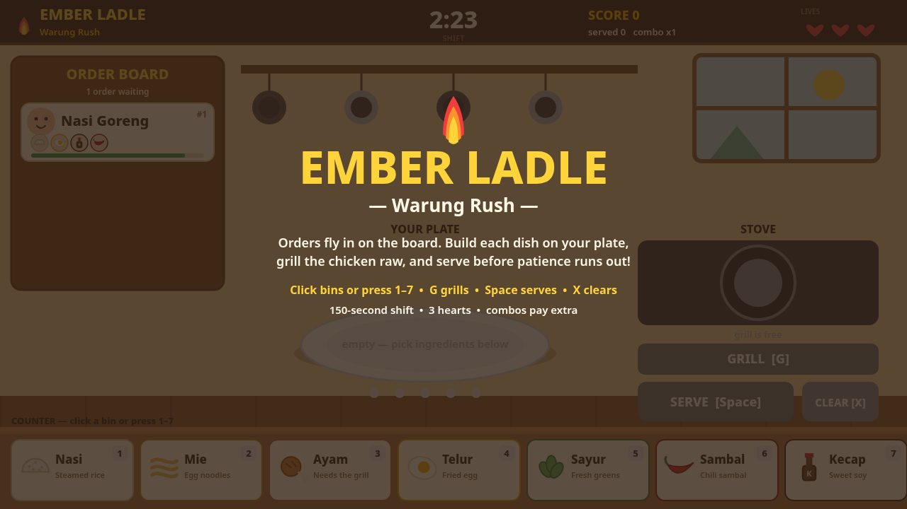
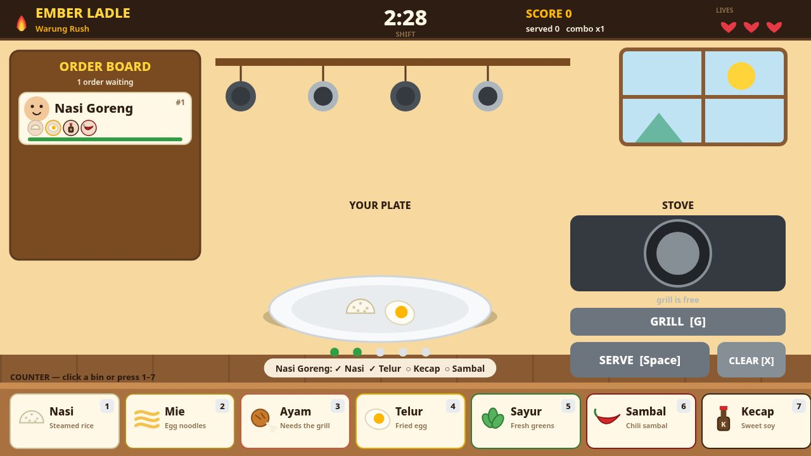
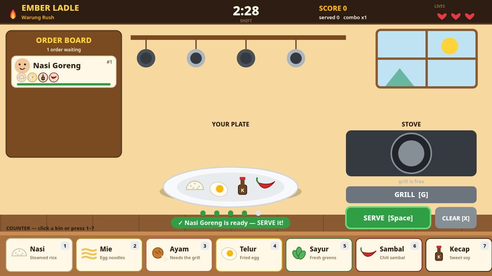
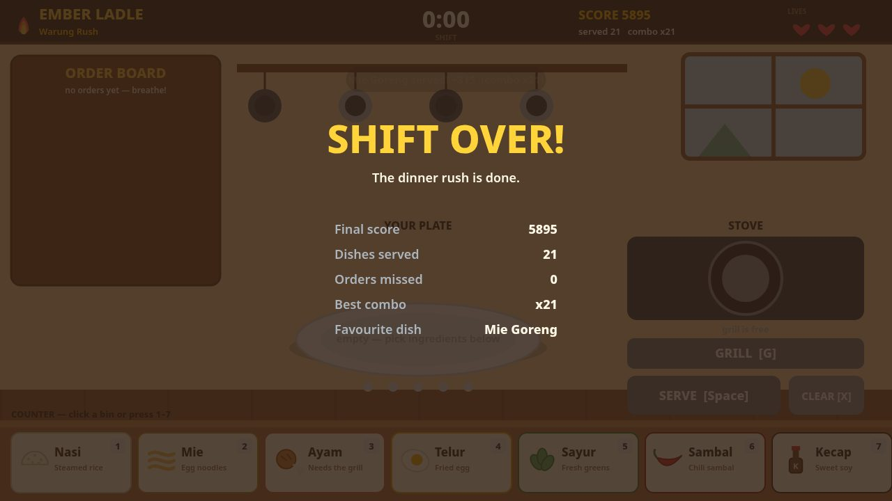

# Ember Ladle — Warung Rush

[](https://make.fun/bounty/best-cooking-game-20261125-0137)
[](https://make.fun/bounty/best-cooking-game-20261125-0137)
[](https://make.fun/bounty/best-cooking-game-20261125-0137)

An original timed cooking game for the [make.fun bounty "Make the best cooking game"](https://make.fun/bounty/best-cooking-game-20261125-0137) — $250 prize pool, top 10 entries share it.

You run a warung kitchen on a 150-second dinner shift: orders land on the order board, you build each dish on your plate from seven ingredient bins, grill raw chicken on the stove, and serve before patience runs out. Fast serves earn tips, chained serves build combos, and three walked-away customers end the shift.

## Play it

```sh
node serve.ts   # then open http://localhost:8080
```

No build step, no network requests, no external assets — plain static files (`game/index.html` + ES modules). Keyboard **1–7** picks ingredients, **G** grills, **Space** serves, **X** clears, **P** pauses, **M** mutes. Mouse works everywhere too.

## Screenshots

| | |
| --- | --- |
|  |  |
|  |  |

## Dossier

See [DOSSIER.md](DOSSIER.md) for the full write-up: rules, controls, scoring, menu, and tech notes. `node main.ts` hands the entry in (copies `game/` + `screenshots/` and writes `dossier.json`).

## License

MIT — see [LICENSE](LICENSE).
